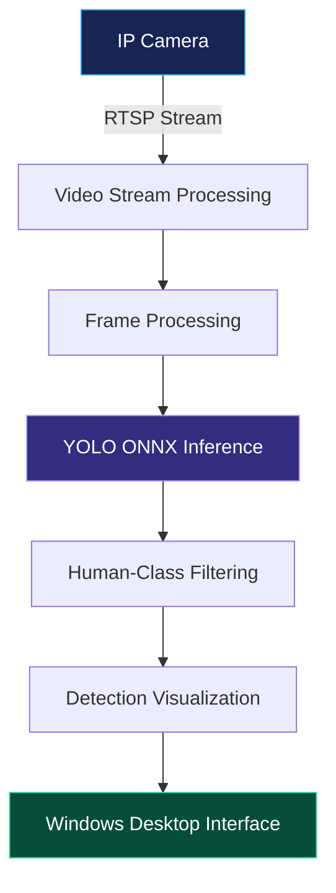

# VisionGuard — Intelligent Camera Human Detection

<p align="center">
  
</p>

<p align="center">
  A Windows desktop application for IP camera monitoring and AI-assisted human detection, built with C# and .NET.
</p>

<p align="center">
  <a href="https://github.com/Abhishek400217/VisionGuard">
    
  </a>
  
  
  
</p>

<p align="center">
  <a href="#-overview">Overview</a> •
  <a href="#-features">Features</a> •
  <a href="#-technology-stack">Tech Stack</a> •
  <a href="#-getting-started">Getting Started</a> •
  <a href="#-roadmap">Roadmap</a>
</p>

---

## 🎯 Overview

**VisionGuard** explores the integration of IP camera streaming and computer vision in a Windows desktop application. It combines live camera footage with YOLO-based human detection to support real-time visual monitoring.

The project focuses on connecting camera-streaming infrastructure with AI inference in a desktop workflow, providing a foundation for further surveillance and monitoring research.

### Why VisionGuard?

- **Live monitoring:** Work with an IP camera stream using RTSP.
- **AI-assisted detection:** Use YOLO ONNX models for human detection.
- **Windows desktop experience:** Built with C# and .NET.
- **Extensible foundation:** Designed as a starting point for additional monitoring and detection capabilities.

## ✨ Features

| Feature | Description |
|---|---|
| 📹 IP camera streaming | Connect to a compatible camera through an RTSP stream. |
| 🧠 Human detection | Apply YOLO-based inference to identify human detections. |
| 🎯 Human-only filtering | Focus detection output on the human class. |
| 🖥️ Desktop interface | Windows Forms interface built with C#. |
| ⚡ Frame processing | Process camera frames for AI inference and visual output. |
| 🧩 ONNX model support | Include ONNX model files for the detection workflow. |

*Feature availability depends on the current application configuration, model, and connected camera.*

## 🛠️ Technology Stack

<p>
  
  
  
  
  
  
  
</p>

- **Language:** C#
- **Framework:** .NET 8 for Windows
- **User interface:** Windows Forms
- **Video input:** RTSP-compatible IP camera
- **Detection:** YOLO model inference using ONNX assets
- **Version control:** Git and GitHub

## 🏗️ Application Workflow



The workflow illustrates the intended processing pipeline. Actual performance depends on camera resolution, model selection, hardware, and implementation details.

## 📂 Project Structure

```text
VisionGuard/
├── .github/                    # Repository configuration
├── MainForm.cs                 # Application logic
├── MainForm.Designer.cs        # Windows Forms UI layout
├── MainForm.resx               # Form resources
├── Program.cs                  # Application entry point
├── VisionGuard.csproj          # Project configuration
├── VisionGuard.sln             # Visual Studio solution
├── yolo26n.onnx                # ONNX model asset
├── yolo26s.onnx                # ONNX model asset
├── yolo26s.pt                  # PyTorch model asset
├── .gitignore
└── README.md
```

*The model files shown above are the assets present in the project directory. Use the model required by your application configuration.*

## 🚀 Getting Started

### Prerequisites

- Windows 10 or Windows 11
- Visual Studio 2022 with the appropriate .NET desktop development components
- .NET 8 SDK
- A compatible IP camera or RTSP stream
- Required NuGet dependencies specified by the project
- The model files required by the application

### 1. Clone the repository

```bash
git clone https://github.com/Abhishek400217/VisionGuard.git
cd VisionGuard
```

### 2. Open the solution

Open `VisionGuard.sln` in Visual Studio 2022.

### 3. Restore dependencies

From the project directory, run:

```bash
dotnet restore
```

### 4. Configure the camera

Configure the RTSP stream using the application's existing camera configuration. Keep credentials private and avoid committing connection strings containing usernames or passwords.

### 5. Build and run

```bash
dotnet build VisionGuard.sln
```

Alternatively, select the appropriate startup project in Visual Studio and press **F5**.

> **Note:** Successful execution requires the correct model assets, camera configuration, and dependencies. The exact setup may vary with your camera and local environment.

## 🖼️ Screenshots & Demo

Screenshots and a demonstration GIF can be added here once captured from the running application.

<p align="center">
  <em>Planned showcase: live camera feed · human detection output · monitoring interface</em>
</p>

To keep the repository authentic, use actual application screenshots rather than illustrative mockups.

## 🗺️ Roadmap

- [x] Windows desktop application foundation
- [x] RTSP camera-streaming workflow
- [x] YOLO ONNX model assets
- [x] Human-class detection filtering
- [ ] Improved diagnostics and structured logging
- [ ] Detection confidence and performance metrics
- [ ] Configurable camera and model settings
- [ ] Event history and optional alert workflows
- [ ] Documentation and demonstration video

*Roadmap items are planned improvements, not claims of existing functionality.*

## 🔒 Security & Privacy

- Never commit camera credentials, API keys, or sensitive configuration.
- Use trusted camera networks and restrict access to camera streams.
- Follow applicable privacy requirements when monitoring people.
- Review model and dependency licenses before redistribution.

## 🤝 Contributing

Contributions, bug reports, and suggestions are welcome.

1. Fork the repository.
2. Create a feature branch.
3. Make and test your changes.
4. Submit a pull request with a clear explanation of the change.

For significant changes, open an issue first to discuss the proposed approach.

## 👨‍💻 Author

**Abhishek Karande**

Software development project exploring computer vision, IP camera streaming, and AI-assisted monitoring.

- GitHub: [@Abhishek400217](https://github.com/Abhishek400217)
- Project repository: [VisionGuard](https://github.com/Abhishek400217/VisionGuard)

## 📄 License

No license has been specified yet. Add a `LICENSE` file before permitting others to reuse or redistribute the project.

---

<p align="center">
  <strong>VisionGuard</strong><br/>
  <sub>Connecting camera streams with intelligent visual monitoring.</sub>
</p>
