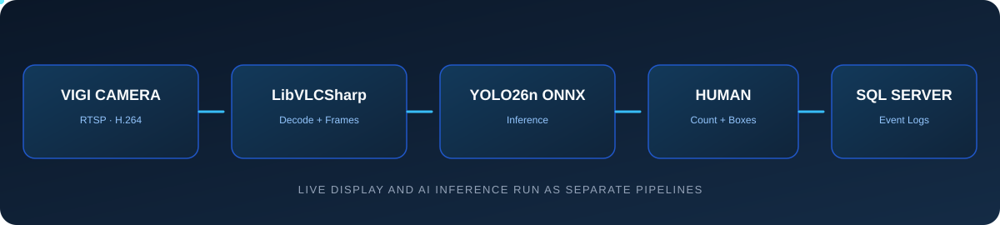

  
   
  
    
  
  
  
  
  
   
  
  
  

---

## Overview

**VisionGuard** is a Windows desktop application for monitoring an IP-camera RTSP stream and detecting people in real time. It combines LibVLCSharp-based video decoding, YOLO ONNX inference, OpenCV image processing and SQL Server event logging in one application.

The project focuses on two practical requirements:

- **Responsive live video:** camera-frame display is kept separate from the AI inference loop so slow inference does not hold the UI to the detector's processing rate.
- **Actionable detection records:** human-detection events, confidence values and timestamps are written to a local SQL Server database.

> **Project status:** Core camera streaming, YOLO human detection and SQL event logging are implemented. Person re-identification, verified person-wise IN/OUT tracking, uniform classification and vehicle-number-plate recognition are roadmap items—not current completed features.

## Live Application

The following screenshots are from the running VisionGuard application.

  
  
   
  Live RTSP feed · YOLO human bounding boxes · Live person count

## Animated System View

  
    
  

## What It Does

| Capability | Implementation |
|---|---|
| IP-camera connectivity | RTSP stream through LibVLCSharp |
| Video decoding | LibVLC / H.264-compatible stream |
| Human detection | YOLO26n ONNX model |
| Image processing | OpenCvSharp |
| AI inference | Microsoft ONNX Runtime |
| Live display | WinForms PictureBox with a dedicated display timer |
| Frame handling | Latest-frame buffer and background inference loop |
| Detection overlay | Human bounding boxes and confidence labels |
| Live counter | Number of humans detected in the processed frame |
| Database | Local SQL Server / LocalDB |
| Event logging | Database connection records and human-detection events |

## Camera Stream Configuration

The VIGI camera was configured for the following test profile:

| Parameter | Configuration |
|---|---|
| Stream | Main Stream |
| Video codec | H.264 |
| Resolution | 1280 × 720 |
| Camera frame-rate setting | 25 FPS |
| Bit-rate control | VBR |
| Maximum bit rate | 4096 Kbps |
| VLC transport | RTSP over TCP |
| VLC network/live caching | 200 ms |

The WinForms display timer is configured for a 40 ms refresh interval (a 25 updates/second target). **That interval is a target, not a benchmark result:** actual displayed FPS and YOLO inference FPS depend on the camera, network, CPU, memory and scene complexity.

## Architecture

  

### Processing Flow

1. The VIGI IP camera publishes an RTSP stream.
2. LibVLCSharp decodes the stream and supplies frames through video callbacks.
3. The latest decoded frame is copied into a shared frame buffer.
4. The UI display timer updates the live preview independently of AI inference.
5. A background processing loop sends the latest available frame to YOLO26n.
6. Human detections are filtered, counted and drawn as a UI overlay.
7. Meaningful detection events are written asynchronously to SQL Server.

## Technology Stack

  

| Layer | Technology |
|---|---|
| Application | C# / .NET 8 Windows Forms |
| Video | LibVLCSharp.WinForms, VideoLAN.LibVLC.Windows |
| Computer vision | OpenCvSharp 4 |
| Detection model | YOLO26n ONNX |
| Inference | Microsoft.ML.OnnxRuntime |
| Database access | Microsoft.Data.SqlClient |
| Database | SQL Server LocalDB |
| IDE | Visual Studio 2022 |

### NuGet Dependencies

The project currently references:

- **LibVLCSharp.WinForms** — 3.10.1
- **VideoLAN.LibVLC.Windows** — 3.0.23.1
- **Microsoft.ML.OnnxRuntime** — 1.30.0
- **OpenCvSharp4** — 4.13.0.20260627
- **OpenCvSharp4.runtime.win** — 4.13.0.20260627
- **Microsoft.Data.SqlClient** — 7.1.1

## Database Logging

VisionGuard uses a local database named **VisionGuardDB**.

Current application logging includes:

- **DatabaseConnectionLogs** — records successful application-to-database connection checks.
- **HumanDetectionEvents** — records human-detection events with camera identifier, detected-person count, confidence and UTC timestamp.

The current event logic is presence-cycle based; it is **not yet a unique-person visit ledger**. Permanent person identity and reliable person-wise entry/exit tracking are planned separately.

### Verify Stored Events

Run this query in SQL Server Management Studio:

~~~sql
USE VisionGuardDB;
GO

SELECT TOP (50) *
FROM dbo.DatabaseConnectionLogs
ORDER BY LogId DESC;

SELECT TOP (50) *
FROM dbo.HumanDetectionEvents
ORDER BY EventId DESC;
~~~

## Getting Started

### Prerequisites

- Windows 10/11
- Visual Studio 2022 with the **.NET desktop development** workload, or .NET 8 SDK
- SQL Server LocalDB (or a compatible SQL Server instance)
- A reachable RTSP-compatible IP camera
- Camera RTSP credentials and stream path
- The YOLO ONNX model file used by the application

### 1. Clone the repository

~~~bash
git clone https://github.com/Abhishek400217/VisionGuard.git
cd VisionGuard
~~~

### 2. Restore dependencies

~~~bash
dotnet restore VisionGuard.sln
~~~

### 3. Configure the camera

Set your camera's RTSP endpoint in the application's camera configuration. The current development setup uses the VIGI main stream.

**Security:** do not commit camera usernames, passwords, private IP details or production connection strings. Move camera credentials to environment variables or a local, untracked configuration file before sharing or deploying the project.

### 4. Configure SQL Server

The development configuration targets:

- **Server:** (localdb)\MSSQLLocalDB
- **Database:** VisionGuardDB
- **Authentication:** Windows Integrated Security

Create the database and the required logging tables before starting the application. If using a different SQL Server instance, update the local connection configuration accordingly.

### 5. Build and run

Open VisionGuard.sln in Visual Studio and run the project, or use:

~~~bash
dotnet build VisionGuard.sln
dotnet run --project VisionGuard.csproj
~~~

Connect the camera from the application UI. When a person is detected, the live counter and bounding-box overlay should update, and the configured SQL Server should receive the relevant detection event.

## Repository Structure

~~~text
VisionGuard/
├── Program.cs
├── MainForm.cs
├── MainForm.Designer.cs
├── MainForm.resx
├── VisionGuard.csproj
├── VisionGuard.sln
├── yolo26n.onnx
├── yolo26s.onnx
├── yolo26s.pt
└── assets/
    ├── visionguard-radar.svg
    ├── visionguard-pipeline.svg
    ├── visionguard-live-1.jpeg
    └── visionguard-live-2.jpeg
~~~

## Roadmap

- [x] RTSP camera connection through LibVLCSharp
- [x] H.264 / 1280×720 / 25 FPS camera configuration
- [x] Live video display separated from YOLO processing
- [x] YOLO ONNX human detection and live count
- [x] Human bounding-box overlay
- [x] SQL Server connection logging
- [x] Human-detection event logging
- [ ] Person tracking with stable session IDs
- [ ] Person-wise camera-view entry and exit history
- [ ] Face-based re-identification (subject to accuracy, privacy and consent requirements)
- [ ] Company-uniform classification
- [ ] Vehicle number-plate detection and OCR
- [ ] Detection and stream-performance benchmarks

## Engineering Notes

- The camera's configured frame rate is not the same as the AI inference rate.
- The latest-frame approach prioritizes freshness over processing every queued frame.
- Face recognition, uniform classification and number-plate reading are not part of the current implementation.
- A detection result should not be treated as proof of a person's identity or authorization.

## Security & Privacy

This application processes live camera footage and may store detection events. Before production use:

- Protect RTSP credentials and database connection details.
- Restrict access to camera streams, logs and snapshots.
- Define retention and deletion policies for recorded data.
- Obtain the required authorization and notices before monitoring people.
- Apply additional safeguards before adding biometric identification.

## Contributing

Issues and improvement suggestions are welcome. For substantial changes, open an issue first so the proposed design can be discussed before implementation.

## Maintainer

**Abhishek Karande** · [GitHub Profile](https://github.com/Abhishek400217)

   
  
   
  

